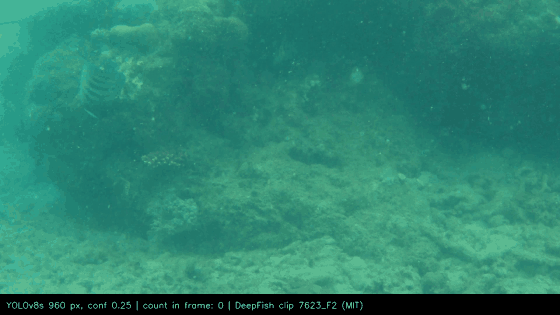
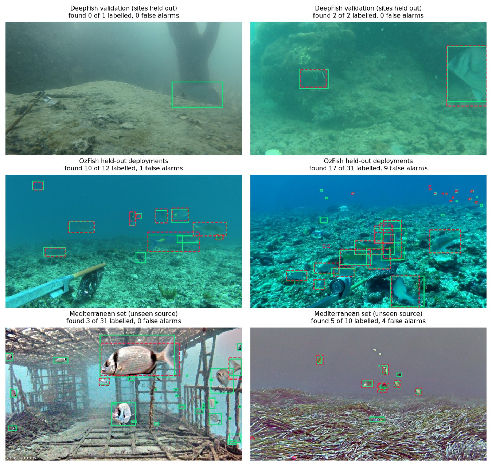
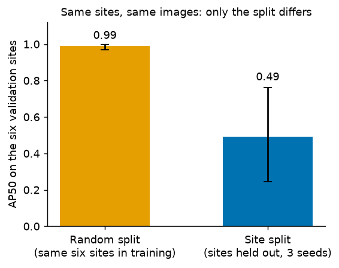

# Fish detection for the Jetson Orin Nano

[](LICENSE)


A single-class fish detector for underwater video, trained with an evaluation protocol designed to catch the ways such scores mislead, and measured end to end on a real Jetson Orin Nano.



*The shipped YOLOv8s detector (960 px, confidence 0.25) on a DeepFish clip. [Full-quality video](docs/images/demo.mp4) (1 MB). Boxes are model output, not labels; the clip is a sample, not a measurement (see the results below for measured numbers).*



*Example detections of the same model on frames picked by a fixed random rule, not by appearance: DeepFish validation sites, held-out OzFish deployments, and an unseen Mediterranean set. Green solid boxes are labels, red dashed boxes are detections. Each title gives fish found of labelled and false alarms. Two frames per source illustrate behaviour and do not measure it.*

## What this project is

- **A detector.** YOLOv8 (Ultralytics), one class (`fish`), fine-tuned from COCO weights on three open datasets: DeepFish, Kakadu and OzFish.
- **An evaluation.** Site-level splits, a sealed test set scored once, same-machine controls with three seeds, cluster-bootstrap intervals, and a test on a source no model saw. All of it is written down before the numbers are read (`docs/eval_protocol.md`).
- **A device measurement.** TensorRT FP16 engines built on a Jetson Orin Nano 8 GB Super, timed end to end (decode, letterbox, GPU, NMS), with 30-minute runs that log frame rate and temperature.

## Results (the short version)

Every row names the finding that holds the evidence, the run folder and the limits: `docs/PROGRESS.md`.

| Question | Result | Evidence |
|---|---|---|
| Does the split change the score? | The same six sites score **0.989 AP50** for a model trained on a random per-image split and **0.491** for site-split models (leakage, not harder sites) | F20, F38 |
| What raises accuracy most? | More diverse training data: YOLOv8n **0.473 → 0.698 → 0.750** mAP@50 (DeepFish; + Kakadu; + OzFish; 3 seeds each). YOLOv8s: **0.812** (3 seeds, range 0.041) | F18, F24, F32 |
| What did not help? | Higher resolution beyond 960, a stride-4 head, test-time tiling, stronger augmentation on top of extra data (several are single-seed screens) | F12, F23, F25–F27 |
| Sealed test (OzFish, new deployments of data also used in training) | **0.700** mAP@50, run once on three seeds; 95% interval 0.669 to 0.724 | F33, F37 |
| A source no model saw (Mediterranean) | Every detector is poor: **0.05 to 0.23 AP50**, including the published YOLO-Fish detectors | F39 |
| Can a few labels fix a new camera? | 25 labelled frames: 0.18 → **0.65 AP50** on later frames of the same camera; small, uncertain gain on other cameras | F41 |
| On the Jetson (25 W, FP16, built on the board) | YOLOv8s **~50 ms per frame** end to end (serial, still images); **24.3 fps** over 30 minutes of looped video, max 59.5 C, no throttling visible | F28, F29, F34 |

The GPU kernel is only 8 to 11% of a frame on the board; decoding, resizing and copying dominate (F8). A kernel benchmark is never reported as a frame rate.



## What it does not show

Read this before quoting a number.

- **No deployment-site footage and no live camera.** Device runs use recorded video and still images.
- **Poor transfer to a new source** (0.05 to 0.23 AP50). The sealed OzFish score measures new deployments of the same collections, not an unseen source.
- **Device evidence is narrow:** one 30-minute run per model, one power mode (25 W) for the long runs, ambient temperature not measured, no INT8, no mAP computed on the device.
- **Several comparisons are single-seed screens,** and checkpoint selection reused the DeepFish validation split (so it is mildly optimistic). Each result entry says which.
- It is a research codebase and a measured baseline, not a finished monitoring product. There is no backend, dashboard or IoT integration in this repository.

## Quick start

You need **Python 3.10 or 3.11**.

```bash
git clone https://github.com/TDuong04/image-fish-AI.git
cd image-fish-AI

py -3.11 -m venv .venv            # Windows
.venv\Scripts\activate

python3.11 -m venv .venv          # Mac / Linux
source .venv/bin/activate

python scripts/bootstrap.py       # installs everything (~5 min)
python scripts/check_env.py       # last line should say READY
```

Run `activate` again in every new terminal. Do not `pip install torch` yourself: on Windows it silently installs a CPU-only build.

### Try the demo on your computer

```bash
python scripts/fetch_models.py    # downloads the checkpoints from the GitHub release and verifies checksums
python demo/app.py                # opens in your browser; upload a photo or a clip
```

Timings it shows are for **your** machine, not a Jetson.

### Run it on the Jetson

`demo/app.py` needs PyTorch, which the Jetson does not have. The board runs `edge/app.py`, which talks to TensorRT engines directly. Engines only work on the board that built them, so they are built there (`edge/build_engines.py`); setup is in `docs/hardware.md` and `edge/README.md`.

```bash
# on the Jetson
python3 edge/app.py --engines-dir engines          # serves 0.0.0.0:7860
# the app has no login: on an untrusted network use --host 127.0.0.1 and an SSH tunnel
```

### Train and evaluate

```bash
python scripts/get_data.py                         # ~1.2 GB, safe to re-run
python scripts/train.py --config smoke             # 2-minute test, accuracy will be bad
python scripts/train.py --config yolov8n_640       # a real run: hours; use 3 seeds
```

Results go to `runs/<date>-<name>/`. **No `metrics.json` means the run did not finish.** The longer version, including the extra datasets, is `docs/TRAINING.md`; every script is listed in `scripts/README.md`.

## Repository layout

| Path | What is in it |
|---|---|
| `src/fish/` | Shared code: paths, device selection, dataset grouping, parity checks |
| `scripts/` | Training, data preparation, evaluation, statistics and figure scripts (index: `scripts/README.md`) |
| `edge/` | Jetson-side code: board probe, engine builder, TensorRT runner, on-device app, sustained test (`edge/README.md`) |
| `demo/` | Workstation demo app and the sample clip (`demo/README.md`) |
| `configs/` | Environment profiles and training configurations |
| `runs/` | Committed run records: configs, metrics, analyses, device logs |
| `docs/` | Findings, protocol, data audit, guides and the report draft (`docs/README.md`) |
| `tests/` | Unit and portability tests (`python -m pytest`) |

## Documentation

| File | Read it when |
|---|---|
| [`docs/PROGRESS.md`](docs/PROGRESS.md) | **Start here:** what was built, every result (F1 to F41), every correction, what is open |
| [`docs/eval_protocol.md`](docs/eval_protocol.md) | **Before quoting any number:** splits, the sealed-set rule, seeds, intervals |
| [`docs/RESEARCH_STORY.md`](docs/RESEARCH_STORY.md) | You want the whole story, the reasoning and the mechanisms, from the start |
| [`docs/GUIDE.md`](docs/GUIDE.md) | You want the concepts explained from the basics |
| [`docs/MODEL_CARD.md`](docs/MODEL_CARD.md) | Intended use, data, performance, limits and checksums of the weights |
| [`docs/hardware.md`](docs/hardware.md) | The board, its verified facts and how to set it up |
| [`docs/TRAINING.md`](docs/TRAINING.md) | You want to train or reproduce a run |
| [`docs/report/`](docs/report/) | The paper drafts and their references |
| [`docs/tickets/BACKLOG.md`](docs/tickets/BACKLOG.md) | What is done and what is next |

## If something breaks

| It says | Do this |
|---|---|
| `Python 3.x is not supported` | Wrong Python. Recreate the venv with `py -3.11`. |
| `Refusing to install into the system Python` | You skipped `activate`. |
| `no GPU available ... CPU-only build` | Run the `pip install` command it prints. |
| `No model files found in models/` | `python scripts/fetch_models.py` |
| `Dataset ... does not exist` | `python scripts/get_data.py` |
| Download stopped halfway | Run `python scripts/get_data.py` again. |

## Data, licence and credits

The code, configurations, documentation and trained weights are released under the **GNU Affero General Public License v3.0** ([`LICENSE`](LICENSE)), because they build on Ultralytics YOLOv8 (AGPL-3.0). If you serve a modified version over a network, offer its source to your users; the apps print a source link from `$FISH_SOURCE_URL` (set it to your repository address when serving).

Datasets are not included and keep their own licences: DeepFish (MIT), Kakadu (CC BY 4.0), OzFish (CC BY 3.0 AU; the converted labels are a derivative work), and the Mediterranean set (CC BY 4.0, used only for evaluation). Credits, the changes made to each dataset and third-party software are in [`NOTICE.md`](NOTICE.md). The clip in the demo is from DeepFish.

Maintained by Huynh Thai Duong.
