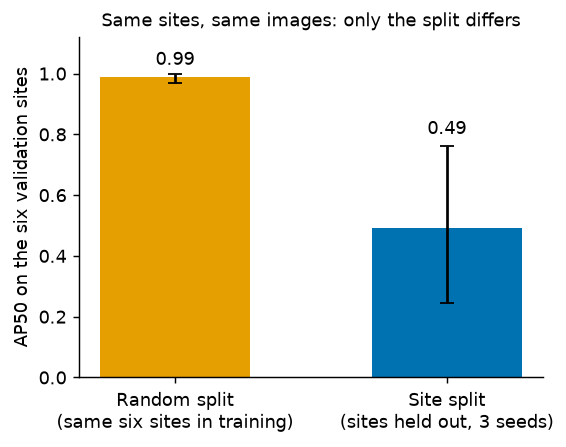
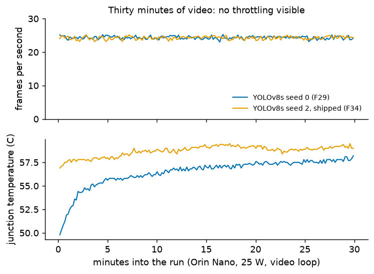
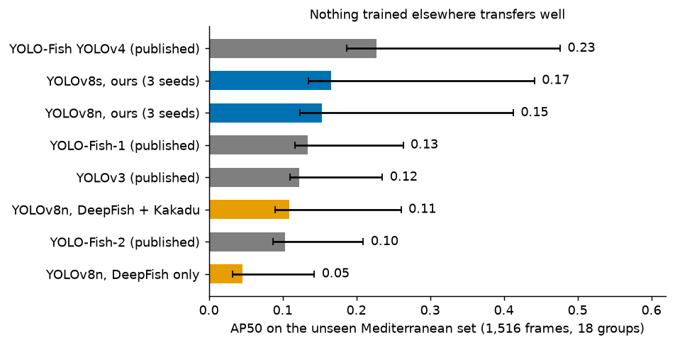
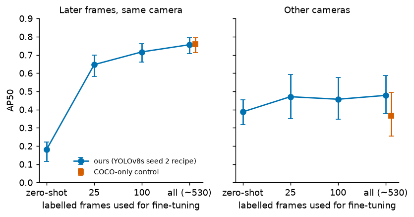

# Detecting fish in underwater video on a Jetson Orin Nano: data, evaluation and deployment of a single-class YOLO detector

*Working title. DRAFT, started 2026-10-06. Sections marked **[PENDING]** cannot be written until the experiments they describe
are finished. Every number carries a finding id (F#) that points to the evidence, run folder and limits in
`docs/PROGRESS.md`; if this text and that file disagree, that file wins. Citations are author-year and tracked in
`references.md` / `references.bib`. Reading order for the structure: Introduction, Related work, Datasets, Method,
Results, Discussion, Limitations, Conclusion, as in comparable fish-detection papers (for example Zhang et al., 2024).*

## Abstract

Fish detectors for underwater video are usually reported with a single score, but that score depends on how the data were split, which data were used and what the model had seen before. We train a single-class YOLOv8 detector from COCO-pretrained weights on three openly licensed datasets (DeepFish, Kakadu, OzFish) and evaluate it with site-level splits, a sealed test set used once, cluster-bootstrap intervals and a source no model saw, then measure it on a Jetson Orin Nano.
Four findings stand out. (1) The split matters more than the model: on identical sites a model trained on a random per-image split scores 0.99 AP50 against 0.49 for models that held the sites out. (2) More diverse training data was the largest lever (DeepFish alone 0.47 mAP@50, with Kakadu 0.70, with OzFish 0.75 for YOLOv8n; YOLOv8s 0.81 over three seeds, range 0.041), while higher resolution, stronger augmentation, a small-object head, test-time tiling and a second detector family did not change the picture. (3) Generalisation to a truly unseen source is poor: on a Mediterranean set, every detector we tried, including published YOLO-Fish models, scored 0.05 to 0.23 AP50; the sealed OzFish test (new deployments of data also used in training) gave 0.70. Fine-tuning on 25 labelled early frames of one fixed camera lifted later frames of that camera from 0.18 to 0.65 AP50, with a small and uncertain gain on other cameras. (4) On the Orin Nano (25 W, TensorRT FP16, built on the board) the shipped YOLOv8s engine takes about 50 ms per frame end to end, holds 24 fps over 30 minutes of video with no throttling visible and agrees with PyTorch on 12 test frames.
We report what the evidence does not show: no footage from a deployment site, one device run per model, single-seed screens for several comparisons, and checkpoint selection on a reused validation split. All numbers are regenerable from committed configurations, code and run records, prepared for release under the AGPL-3.0.

## 1. Introduction

Monitoring fish with underwater cameras produces far more footage than people can review. Baited remote underwater
video stations (BRUVS) and fixed cameras record for hours, and most frames contain no fish at all. Automatic detection
would turn that footage into counts and presence records, and running the detector on a small computer at the camera
would let a field unit filter its own footage. This project asks a practical version of that question: **how accurate
can a fish detector be made, and what does it cost to run on a Jetson Orin Nano, when both answers are measured on the
real device and on data the model has not seen?**

Three things make the question harder than a benchmark number suggests.

1. **Scores depend heavily on how the data are split.** Underwater datasets are made of video frames, and neighbouring
   frames are nearly identical. A random per-image split lets the model see almost the same picture in training and in
   testing. We measured the effect on our own pipeline: the same model scores 0.98 mAP@50 on a random per-image split of
   DeepFish and about 0.47 when whole capture sites are held out (F20), and on identical sites a model that saw neighbouring frames scores 0.989 AP50 against 0.491 for models that did not (F38). Results from the literature should not be
   compared with ours unless the protocol is known to match (Kapoor and Narayanan, 2023, discuss leakage of this kind
   across machine-learning-based science).
2. **Fish are small.** At the resolutions that suit a small device, many fish occupy a few tens of pixels, and detection
   quality collapses below about 32 pixels (F3, F10).
3. **A desktop speed is not a device speed.** On the Jetson the network itself is a small part of the time per frame
   (F8), so GPU-only benchmarks mislead.

**Contributions.** (i) A leakage-controlled evaluation protocol and a record of how much it changes the numbers.
(ii) An error analysis that locates the failures (which fish are missed, which boxes are false alarms) instead of
reporting a single score. (iii) A controlled study of what raises accuracy: input resolution, additional training
data, model size, and test-time tiling, with seed variance measured rather than assumed. (iv) End-to-end and
30-minute sustained measurements (one run per model, one power mode) of the detector on a Jetson Orin Nano, with the power mode and clocks stated.

Throughout, we separate **observations** from **claims**: one seed, one split or one dataset supports "observed", and
the report says so.

## 2. Related work

### 2.1 Fish detection in underwater images

Early work on fish detection in underwater video compared hand-crafted features with classifiers against convolutional networks (Villon et al., 2016) and later moved to deep detectors, including motion-aware systems
(Salman et al., 2020; background subtraction and optical flow combined with a region-based CNN, tested on Fish4Knowledge and LifeCLEF videos with F-scores of 87.4% and 80.0%) and object detection for estimating fish abundance in the field (Ditria et al., 2020); deep learning is also applied to species recognition and quantification on board fishing vessels (Ovalle et al., 2022).
Ditria et al. trained Mask R-CNN on 6,080 annotations of one species (luderick) in seagrass and scored mAP@50 of 0.925 on unseen footage from the training estuary and 0.934 on a second estuary (32 videos each); the setting is one species in one habitat type, and their random 80:20 split was between training and validation only, so it is not comparable with our tropical-to-Mediterranean result (Section 5.10).
Most recent systems build on the YOLO family, which combines a single-pass design (Redmon et al., 2016) with real-time speed. YOLO-Fish adapted YOLOv3 and YOLOv4 variants to realistic underwater scenes
using DeepFish and OzFish imagery and reported average precision of roughly three quarters (Muksit et al., 2022) (76.56% and 75.70% AP, which a repository copy of the abstract assigns to its two variants and a later paper to DeepFish and OzFish respectively; **the article is not open access and we could not read it, so the figures and what they refer to must be confirmed before publishing**); its
weights are public and we evaluate them on an unseen source (Section 5.10). Ayyagari et al. (2025) pre-trained YOLOv7 on three public marine datasets and fine-tuned it on their own 221-video set (videos split 70/15/15); pre-training on OzFish gave faster convergence and mAP 0.896 against 0.854 without it at 500 training samples, while on an out-of-distribution set (Brackish) every model was poor (0.124 with OzFish pre-training, 0.026 without). The public datasets were split by random image, and the authors list poor out-of-distribution performance as a limitation, which agrees in direction with our Section 5.10. Later work modifies YOLOv8-class detectors for fish: Zhang et al. (2024) add a space-to-depth convolution, an attention module and an extra small-target
detection layer to YOLOv8n for fish in natural waters, and AquaYOLO (Vijayalakshmi and Sasithradevi, 2025) targets pond aquaculture monitoring. The AquaYOLO paper evaluates on its own pond dataset
(about 8,150 images and 50,000 boxes from aquaponds in South India, not public), split 70/20/10 into 5,705, 1,630 and 815 images without any site- or video-level separation being described, and reports mAP@50 of 0.909 there and 0.814 on DeepFish and OzFish combined;
we read these figures in the paper itself. The same paper also scored YOLO-Fish on its own pond data and reports an mAP of 0.157 (its Table 5), a different task and metric implementation from ours but in line with the poor transfer to an unseen source that we find for the published detectors (Section 5.10). These papers differ in datasets, splits, image sizes and metric definitions, so their numbers are not directly comparable with each other or with ours; we therefore
quote none of them as a baseline and compare detectors only on a source that none of them saw (Section 5.10). Surveys of generic object detection (Liu et al., 2020) place YOLO-style single-stage and R-CNN-style two-stage detectors (Ren et al., 2017) as the two main families,
which is why the second family we test is a Faster R-CNN.

### 2.2 BRUVS and stereo video

BRUVS are a standard tool in fish ecology. Deep-learning models for BRUVS include generalised models for
semi-automated length measurement in stereo-BRUVS (Marrable et al., 2023). An earlier paper from the same group (Marrable et al., 2022) fine-tunes a COCO-pretrained YOLOv5-large to find fish on OzFish and reports, for a fish-only detector, precision 0.898 and recall 0.699, and out-of-sample recall of 0.70 to 0.89 on three further OzFish subsets and 0.70 on DeepFish; its split (66/17/17 "by class") is not described as by deployment or video, so these are not comparable with our site-level results. The 2023 work fine-tunes a COCO-pretrained YOLOv5s with early stopping, as we do, but to find head and tail points on fish crops cut from OzFish stereo pairs; it drops fish smaller than 200 pixels in height or width, and it holds out OzFish deployments (by filename prefix) as out-of-sample test data. Dropping small fish is the opposite of our reporting of recall by size (F10, F11). Our footage includes baited, crowded
scenes (OzFish) as well as sparse reef scenes (DeepFish), and the two behave differently (F2).
What a BRUVS study needs from a detector is a count or a measurement per video, not a box per frame. Baited remote underwater video collects relative-abundance data across many habitats, and Marrable et al. (2023) motivate automation by the labour that manual analysis and measurement still require, even when footage is recorded remotely. The usual abundance summary is MaxN, the largest number of fish visible in any single frame of a video; Ditria et al. (2020) score a detector on MaxN and note that false positives and false negatives can cancel each other in that count, so an accurate MaxN does not show an accurate detector. This is why we report counting error and found and missed fish alongside AP (F36) and why we treat the detector as a tool that produces boxes for later summaries.
The OzFish boxes are described in the dataset documentation as crowd-sourced; fish ecologists marked the head and tail points used for length measurement (Marrable et al., 2023), and Marrable et al. (2022) relabelled point annotations of two species as bounding boxes. An unlabelled fish therefore scores as a false alarm, a limitation we state in Section 7.

### 2.3 Small objects and tiling

Small objects are a known weakness of single-stage detectors. A common remedy is slicing the image into overlapping
tiles at test time and merging the results (Akyon et al., 2022); SAHI uses 25% overlap between slices, merges with non-maximum suppression at a 0.5 matching threshold, and can add a pass over the full image for large objects, and it was evaluated on aerial datasets (VisDrone, xView). We test this on our best model and report that it
did not help here (Section 5.6), including a small-box merge rule fixed in advance.

### 2.4 Generalisation to new locations and evaluation practice

Recognition models trained at some camera locations can fail at others: Beery et al. (2018) state that state-of-the-art algorithms perform well at the locations they were trained on but that generalisation to new locations is poor, especially for classification (their data are camera traps, not underwater). Kapoor and Narayanan (2023) list non-independence between training and test samples as a leakage type, unless the claim concerns a distribution with the same dependence structure, and suggest partitioning that respects the dependencies (block cross-validation); they found leakage in 329 papers across 17 fields. That is the reason we separate sites in every split and add a test on a source that no training or selection data came from. Reuse of a test set is a separate threat. Dwork et al. (2015) show that reusing a holdout adaptively can invalidate the estimates (their remedy is to perturb the answers); Recht et al. (2019) built fresh test sets for CIFAR-10 and ImageNet, saw accuracy drops of 3 to 15% and 11 to 14%, and attributed them to harder images, not to adaptive overfitting; Roelofs et al. (2019) compared public and final rankings in more than 100 Kaggle competitions and found little evidence of substantial overfitting. We therefore use the sealed OzFish set once, report its uncertainty by a pre-declared second pass over the same predictions (F37), and state that checkpoint selection reused the validation split (Section 7). Varoquaux (2018) shows in neuroimaging that the standard error across cross-validation folds underestimates the error bars (about 10% at 100 samples), which is why our intervals come from a cluster bootstrap over clips, sites or dates. The REFORMS checklist (Kapoor et al., 2024) is a 32-question reporting standard for machine-learning science; we did not read its individual items and use it here only as pointer to a reporting standard. Average precision with an IoU criterion of 0.5 follows the PASCAL VOC convention (Everingham et al., 2010) and
the COCO-style average over IoU 0.50 to 0.95 (Lin et al., 2014). Duplicate boxes are removed by non-maximum
suppression (Neubeck and Van Gool, 2006).

## 3. Datasets

All annotation is converted to a single class, `fish`. Frames are 1920x1080 unless stated.

### 3.1 DeepFish (training and validation)

DeepFish (Saleh et al., 2020) provides underwater video frames from tropical Australian habitats. We use the
YOLO-format box export released with YOLO-Fish: 6,517 images and 15,463 boxes. We split by **capture site** (14
training sites, 5,178 images and 14,078 boxes, 29.9% empty frames; 6 validation sites, 1,339 images and 1,385
boxes, 34.7% empty frames). The split is committed and the code asserts that no site appears on both sides (`docs/data_audit.md`).
This validation split is the common yardstick for all models in this report.

**Figure 1.** The split decides the score. AP50 on the same six DeepFish validation sites (46 clips): a YOLOv8n trained on a random per-image split, which saw neighbouring frames of these sites, scores 0.989; three site-split YOLOv8n controls score 0.491 (95% cluster-bootstrap intervals over clips; note the wide interval on the second bar). Record: `runs/stats-20261011-leakage-control/leakage.json` (F38). Drawn by `scripts/make_figures.py`.

### 3.2 Kakadu (extra training data only)

The Kakadu dataset (Jansen et al., 2022; CC BY 4.0) has 44,112 frames and 82,904 boxes of 23 freshwater taxa from
remote underwater video in northern Australia. It carries no site or video labels, so we grouped frames by picture
similarity (small mean-removed grayscale thumbnails, L1 distance, single linkage at a threshold of 4.0, giving 2,296
groups), kept at most 15 frames per group, and obtained 7,318 frames with 11,695 boxes. A held-out split inside Kakadu
still leaked (the closest train-validation pairs were the same scene), so Kakadu is used **for training only**
(F13). Every Kakadu frame contains a fish, so it cannot measure false alarms.

### 3.3 OzFish (held-out evaluation, then partly training)

OzFish (Australian Institute of Marine Science et al., 2019; CC BY 3.0 AU) holds crowded BRUVS frames with
crowd-sourced boxes, unlabelled by species for the detection task. Our sealed test set has 352 frames, 8,329 boxes
and no empty frames (297 clips, 23.7 boxes per frame against 2.4 in DeepFish). The sealed set was used for the
baseline cross-dataset result (F2) and, after the final recipe was fixed, once more on the three YOLOv8s seeds (F33). We later obtained the
labelled OzFish frames. Because the test frames come from the same labelled pool, we excluded every deployment that
appears in the test set (leaving 794 of 1,758 frames, 779 after a near-duplicate filter), and held out whole deployments (157 frames) as a decision-only validation set, with 622 frames for
training. Training on OzFish changes what the sealed test measures: it then tests new deployments of the same
collections, not an unseen source.

### 3.4 Data not used

The CFC dataset is sonar imagery, a different modality, and is not used for optical training. YOLO-Fish weights
are a reference, not a baseline we reproduce.

## 4. Method

### 4.1 Detector

We use YOLOv8 (Ultralytics; Jocher et al., 2023) in nano, small and medium sizes, and YOLO11s for one comparison. The
network is a convolutional backbone, a multi-scale neck and an anchor-free head that predicts boxes at three strides
(8, 16, 32); overlapping predictions are removed by non-maximum suppression (Neubeck and Van Gool, 2006). We use the
single `fish` class. A variant with an extra stride-4 head was tried for small fish (F12).

### 4.2 Training

Models start from COCO-pretrained weights (Lin et al., 2014) and are fine-tuned for at most 150 epochs with
early stopping (patience 30) and Ultralytics' default augmentation (mosaic with the last 10 epochs off, small
hue and scale jitter). Checkpoints are chosen by Ultralytics' fitness, 0.1 x mAP@50 + 0.9 x mAP@50-95, on the
DeepFish validation split. Input size is 640, 960 or 1280 px on the long side, letterboxed (a 1080p frame is
evaluated at 544x960 for 960). The first baseline runs (YOLOv8n, 640 and 960, three seeds each) used a Kaggle T4; all
later runs used one 8 GB RTX 5060 server, with batch sizes chosen automatically (YOLOv8n 10, YOLOv8s 5, 1280 px 3).
Seeds, configs, library versions and the git commit are stored with every run. Ultralytics versions differ across the
phases (8.4.130 workstation, 8.4.159 Kaggle, 8.4.172 server).

### 4.3 Evaluation protocol

- **Splits** are by capture site, never by image, and the sealed OzFish test set is used once (Section 3). Leakage
  is checked by a distance test on thumbnails as well as by site labels, which we found necessary but not sufficient (F13).
- **Metrics.** mAP@50 and mAP@50-95 (Everingham et al., 2010; Lin et al., 2014) from Ultralytics for the headline
  tables; a separate error analysis at IoU 0.5 and confidence 0.25 reports fish found and missed, false alarms by cause
  (duplicate, badly placed, background), false alarms on empty frames, and recall by box size (under 16, 16-32, 32-96 and
  over 96 px, measured as seen at 640 px input). Empty frames matter because BRUVS footage is mostly empty and mAP hides
  false alarms.
- **Controls and seeds.** Every comparison uses a same-machine, same-batch control. The seed spread of the baseline on
  the same machine was 0.041 mAP@50, so differences below that are not results, and any claim needs three seeds
  reported as a mean and range. One seed is called a screen. The machine, batch size and library version alone moved the same-seed
  score by about 0.03 mAP@50, which is why cross-machine comparisons are not used.
- **Frames are not independent.** Frames from one video are near duplicates, so per-frame scores look more certain
  than they are; we say so with each table.
- **Rules fixed in advance.** The tiling merge rules (Section 5.6) were fixed before running and all were reported.

### 4.4 Test-time tiling

For the tiling study (F25, F26) the checkpoint is run on overlapping tiles (20% overlap, 2x2 and 3x3) as well as the
whole frame, tile boxes touching an inner tile edge are dropped (a cut fish gives a partial box), and boxes are merged
by NMS. A small-box variant keeps a tile box only if the fish is at most 32 px at 640-px scale, optionally with a 0.4
confidence floor on tile boxes. One average-precision routine scores every variant, including the untiled control
(it gives 0.8167 against Ultralytics' 0.8209 for the same checkpoint). The idea follows sliced inference (Akyon et al.,
2022); the merge rules are ours.

### 4.5 Deployment on the Jetson Orin Nano

Target: Jetson Orin Nano 8 GB Super developer kit, L4T 36.4.7, CUDA 12.6, TensorRT 10.3.0, active fan, SD-card boot.
Models are exported to ONNX on a desktop and TensorRT engines are built **on the board**, since engines are specific to
the GPU, TensorRT version and driver. FP16 engines are built at the shape the accuracy was evaluated at (384x640 and
544x960), so latency and accuracy describe the same workload. Every frame-rate figure states the `nvpmodel` mode.
Latency is end to end (decode, letterbox, inference, NMS), warm-up discarded, median and 95th percentile. A GPU
kernel benchmark is reported as such and never called a frame rate. Agreement between the engine and PyTorch is
checked on real frames (F7).

## 5. Results

### 5.1 Resolution and the baseline (F1, F2)

On the DeepFish validation split, YOLOv8n trained at 960 px reaches 0.502 mAP@50 (mean of three seeds; sd 0.018)
against 0.416 at 640 px (sd 0.030): +0.087, and every 960 run beats every 640 run (F1). The first Kaggle-trained
baselines are in-domain figures from a short, single-source dataset and sit well below published numbers for the
reasons in Section 4.3; we do not compare against them. They were trained on a different machine, batch size and library version
from the later server runs, which alone moves a same-seed score by about 0.03 (Section 4.3), so the Kaggle 960 px mean (0.502) is not set beside
the server control of Section 5.4 (0.473); the Kaggle runs are marked as not regenerable in the run register.

### 5.2 The in-domain advantage largely vanishes on a different dataset (F2)

On the sealed OzFish set, the two models score 0.204 (640) and 0.217 (960) mAP@50, a loss of 51% and 57% from in-domain,
and the 960 advantage shrinks from +0.087 to +0.013. The test is crowded baited footage (23.7 boxes per image) and the
training data sparse reef footage (2.4), so the loss mixes a change of scene, density and camera. These are the
baseline models trained before any OzFish data were used.

### 5.3 Where the detector fails (F3, F10, F11, F19)

Recall depends strongly on fish size (YOLOv8n, 960 px): about 3% for 16-32 px fish, 49% for 32-96 px and 91% above
96 px (one seed, F10; the three-seed means in F3 agree to within a few points). **Missing fish, not wrongly placed
boxes, limits the detector:** at 960 px, 523 of 688 missed fish had no prediction at all, 161 were found below the 0.25
threshold, and only 4 were badly placed (F10). Most false alarms fall on background (321 of 365). Used as a counter (MaxN is the largest number of fish seen in a single frame of a clip, the usual ecological summary), the detector counts about 80% of the labelled fish per frame on the DeepFish validation split (YOLOv8s, 79 to 84% over three seeds), but its clip-level maximum count is over-estimated (119 to 150% of the true maximum) because false alarms inflate the largest frame (F36). On the 464 empty validation frames the three YOLOv8s seeds raise 24, 268 and 21 false alarms at the default 0.25 threshold (F32), so the empty-frame false-alarm rate is also seed-dependent. A manual audit of a
sample found that most "misses" were visible fish rather than label errors (F11, one reviewer, a sample). Empty frames
explain less than 0.03 of the mAP@50 gap to published figures (F19), and the split protocol explains the rest of that gap
(F20, Section 1). A colour perturbation study showed the model tolerates missing colour (greyscale -7% to -9%) but not
wrong colour (hue shifts up to -49%; F4), which is relevant because water colour shifts with depth.

### 5.4 More diverse data is the largest lever (F17, F18, F21, F23, F24)

Same machine, same batch, three seeds each, DeepFish validation, YOLOv8n at 960 px:

| Training data | mAP@50 (mean, range) | mAP@50-95 | Held-out OzFish mAP@50 |
|---|---|---|---|
| DeepFish only (control) | 0.473 (0.456 to 0.497) | 0.301 | 0.256 |
| + Kakadu | 0.698 (0.684 to 0.709) | 0.471 | 0.357 |
| + Kakadu + OzFish | 0.750 (0.740 to 0.764) | 0.514 | 0.689 |

Adding Kakadu raised the score by 0.225, every seed far above every control seed (F18), and the gain held on unseen OzFish
deployments (about +0.10 mAP@50; F21). Adding the OzFish training frames raised it by a further 0.052; the weakest
combined seed (0.740) is above the best Kakadu-only seed (0.709) (F24). Stronger augmentation added nothing measurable
on top of OzFish data (F23, one seed per arm), so the gain is attributed to the data. Held-out OzFish deployments may share
reefs with the training deployments, and DeepFish validation resembles Kakadu (F13), so these gains may be flattered.
When whole clips of the validation split are resampled instead of frames (20 clips, 1,000 paired resamples, F35), the Kakadu gain (+0.234 AP50, 95% interval 0.116 to 0.339) and the YOLOv8s lead over YOLOv8n (+0.058, 0.012 to 0.104) stay clearly positive, but the OzFish gain (+0.037, -0.001 to 0.091) is not separated from zero, so it is reported as positive on every seed and probably real, not as established. Absolute scores carry an uncertainty of roughly 0.1 at this number of clips. False alarms at the default threshold varied a lot between seeds (155, 477, 175) and the best-F1 threshold moved from 0.2
to 0.4, so an operating threshold has to be chosen per model on validation (F24).

### 5.5 Model size (F14 to F16, F24, F32)

Larger models on DeepFish alone gave one-seed gains that were later shown to depend on data. On the combined data YOLOv8s (batch 5, three seeds) scored a mean of 0.812 mAP@50 (seeds 0.821, 0.787, 0.829; range 0.041) and 0.567 mAP@50-95, against 0.750 and 0.514 for the YOLOv8n mean (range 0.024): every YOLOv8s seed is above every YOLOv8n seed, and on held-out OzFish the means are 0.729 and 0.689 (F32). YOLOv8s found about 1,009 of 1,385 fish at the default threshold (YOLOv8n arm: 910) and 29% of 16-32 px fish (15%). False alarms at a fixed 0.25 threshold varied from 80 to 601 between YOLOv8s seeds because the models differ in calibration, so an operating threshold has to be chosen per model on validation. The YOLOv8s seed spread is larger than the YOLOv8n spread, and its batch size differs (5 against 10). It costs about three times the compute per image and 9 ms more per frame on the Orin (Section 5.8).

### 5.6 Test-time tiling does not help (F25, F26)

| Variant (YOLOv8s, DeepFish val) | AP50 | AP50-95 | Fish found (of 1,385) | False alarms |
|---|---|---|---|---|
| Whole frame (control) | 0.817 | 0.556 | 1,004 | 123 |
| 2x2 tiles + whole frame | 0.791 | 0.544 | 1,085 | 459 |
| 3x3 tiles + whole frame | 0.784 | 0.549 | 1,080 | 611 |
| 2x2, small tile boxes, conf floor 0.4 | 0.812 | 0.554 | 1,019 | 181 |

Tiling finds 8% more fish and raises recall for 16-32 px fish from 26% to 37 to 39%, but false alarms rise 3.7 to 5
times and AP falls; restricting tile boxes to small fish recovers most of the loss but no variant beats the whole frame.
It also costs 5 to 10 network passes per frame. One checkpoint, one split, fixed tilings.

### 5.7 Higher input resolution (F27)

A YOLOv8s run at 1280 px, with the Kakadu and OzFish frames re-cut at 1280 px so that they are not up-scaled from 960, tests whether more pixels per fish raise small-fish recall. They did not: recall on 16-32 px fish was 24.5% against 26.4% for the 960 px model (fish under 16 px: 0 of 10 in both), the number of fish found was the same (1,009 against 1,004), DeepFish validation mAP@50 was 0.785 against 0.821 (mAP@50-95 0.555 against 0.562), and false alarms at the default threshold were higher (344 against 122; the best-F1 confidence moved from 0.25 to 0.5). On held-out OzFish the 1280 px model scored slightly higher (0.736 against 0.724 mAP@50), similar in size to the seed spread of the YOLOv8n arm. One seed each and different batch sizes (3 against 5), so this is a screen; training took 1.7 times longer per epoch.

### 5.8 Device measurements on the Jetson Orin Nano (F6 to F9, F28 to F34)

All figures are for YOLOv8n FP16 engines built on the board (25 W mode, clocks not locked, fan on, `trtexec` and the
project's own runner).

| Measure | 640 (384x640) | 960 (544x960) |
|---|---|---|
| GPU kernel time, median (a 20 s burst, not a frame rate) | 2.56 ms | 4.37 ms |
| End to end, serial pipeline, median | 32.8 ms (30.5 fps) | 40.8 ms (24.5 fps) |
| Share of the frame spent in the GPU kernel | 8% | 11% |

The GPU kernel is a small part of each frame; JPEG decode, letterboxing and host-device copies dominate (F8). In a 30
minute run at 960 px with video decode (H.264 decode takes about 8 ms per frame against about 17.5 ms for the JPEG decode of the serial table, which is why the video loop reaches about 34 fps and the serial figure is 24.5 fps for the same engine), the frame rate held at about 34 fps (first and last two minutes within 0.5%),
the junction temperature rose from about 50 to 56.5 C and flattened, input power was about 6.5 to 7.1 W, and no
throttling was visible (F9; one run, ambient assumed 26 C, GPU clock reading unusable). The engines match PyTorch on 12
real frames (F7). **The larger model costs more on the device (F28):** a YOLOv8s engine trained on the combined data takes 50.1 ms per frame end to end (serial, JPEG decode, 25 W, 200 runs) against 40.8 ms for the YOLOv8n engine, because only the GPU stage grows (23.6 against 14.3 ms); the serial frame rate falls from about 24.5 to 19.9 fps. In a 30 minute run with video decode the YOLOv8s engine held 24.4 fps (against 34 fps for YOLOv8n), the junction temperature plateaued near 58 C and no throttling was visible (F29; one run, 25 W, ambient not measured). The seed 2 engine, the one chosen to ship, reproduced these figures (49.9 ms serial, 24.3 fps over 30 minutes of video, 59.5 C maximum, no throttling visible) and agrees with PyTorch on all 12 test frames (F34). Switching the board to MAXN_SUPER left the GPU stage unchanged (14.3 and 23.5 ms) and sped up only CPU JPEG decode (about 4 ms), so the serial totals fell by 9 to 10% but the 10-minute video frame rates did not change (F31). A control rerun of the original baseline engine gave 41.0 ms, matching F8. **Not measured:** the 15 W and 7 W power modes, INT8, mAP computed on the device, NVDEC hardware decode, and agreement with PyTorch beyond 12 frames. On those 12 frames the YOLOv8s engine agrees with PyTorch on every detection (worst IoU 0.990), while the new YOLOv8n engine matches every detection but fails the preset IoU gate on one 9-pixel box in a crowded frame (IoU 0.708, F30).

**Figure 2.** Thirty minutes of looped video on the Orin Nano (25 W, `jetson_clocks` inactive, software H.264 decode), YOLOv8s FP16 engines of seed 0 (F29) and seed 2, the shipped one (F34). Frame rate stays at about 24 fps; junction temperature rises a few degrees and levels off (the temperature axis does not start at zero, and the seed 2 run started warm). Ambient not measured; one run each. Records: `runs/device-20261007/sustained_*.jsonl`.

### 5.9 Sealed cross-dataset test (F33)

The sealed OzFish test set (352 frames, 8,329 boxes, 297 clips from deployments excluded from training) was evaluated once on the three YOLOv8s seeds, under a plan fixed in the evaluation protocol before the run: mean mAP@50 **0.700** (seeds 0.695, 0.701, 0.705) and mAP@50-95 **0.380** (0.376, 0.381, 0.385), precision 0.807 and recall 0.610 at the default operating point. This is close to the 0.729 mAP@50 on the held-out OzFish deployments used for decisions (F32), and far above the 0.217 of the DeepFish-only YOLOv8n baselines on the same set (F2); that comparison mixes model size, Kakadu data and OzFish data. Because OzFish frames were in training, the test measures new deployments of the same footage, not an unseen source. No seed was chosen from the result, nothing was tuned on it, and the YOLOv8n arm was not evaluated on it. Because the first pass kept no boxes and so gave no interval, the same three fixed models were scored a second time, only to add uncertainty and under rules fixed beforehand (the sealed set was therefore scored twice): resampling the 249 deployments gives a mean AP50 of 0.697 with a 95% interval of 0.669 to 0.724 (AP50-95 0.379, 0.355 to 0.403), with the routine's point values within 0.005 of the first pass (F37). The point estimates quoted above are the first pass's. The set has no empty frames, so it says nothing about false alarms.

### 5.10 An unseen source and the published detectors (F39)

To test generalisation beyond the OzFish collections, the detectors were scored once on a Mediterranean fish set (Catalan and Alvarez-Ellacuria, 2023; 1,516 frames, 17,157 boxes after conversion to one class) that no training, validation or selection data came from, under rules fixed beforehand (evaluation protocol, item 10), together with the published YOLO-Fish detectors as the external comparison.
Every detector does poorly: AP50 is 0.045 for the DeepFish-only YOLOv8n, 0.109 with Kakadu added, 0.154 with OzFish, 0.166 for YOLOv8s (three seeds each), and 0.104 to 0.134 for YOLO-Fish-1, YOLO-Fish-2 and YOLOv3, while the published YOLOv4 scores highest at 0.227, with wide intervals over 18 groups (0.136 to 0.442 for YOLOv8s). Our YOLOv8s finds about 13 to 15% of the fish at the default threshold.
The ordering of our own arms reproduces the data finding of Section 5.4 on an unseen source, but the absolute level shows that cross-source generalisation is weak, and that the sealed OzFish score (Section 5.9) is not a cross-source score. The YOLOv4 weights are about eleven times larger than ours and were trained on different data, so the comparison is not a claim of superiority either way.
A confidence threshold chosen on DeepFish validation also lands at very different operating points on this source (precision 0.54 to 0.86 across the three seeds), so thresholds must be re-chosen on target footage.

**Figure 3.** AP50 on the unseen Mediterranean set (1,516 frames, 18 groups) for our detectors and the published YOLO-Fish detectors. Bars are arm means (ours: three seeds); error bars are 95% intervals over groups only, and are wide. Our scoring routine (101-point AP) differs slightly from Ultralytics mAP and the published detectors were run through OpenCV with our own letterboxing. Record: `runs/unseen-20261011-deepecomar-labels/unseen.json` (F39).

### 5.11 A second detector family (F40)

To test whether the data finding is specific to YOLO, a torchvision Faster R-CNN with a MobileNetV3-Large FPN backbone (Ren et al., 2017; BSD-licensed code, COCO-pretrained) was trained on the DeepFish-only and the combined data (one seed each, 12 epochs).
Adding the data raised AP50 on DeepFish validation from 0.554 to 0.660 (+0.105) and on the unseen Mediterranean source from 0.098 to 0.134 (+0.036, scored after the main unseen result was read), the same direction as every YOLO arm. The two families rank differently at the two ends: with DeepFish only the Faster R-CNN scores higher than the YOLOv8n controls (0.554 against 0.470),
and with the combined data lower than YOLOv8n (0.740) and YOLOv8s (0.798). These are single seeds of a short untuned recipe, so the comparison between families is indicative only; the claim supported is that the benefit of diverse training data is not specific to YOLO.

### 5.12 Adapting to a fixed camera (F41)
F39 left the unseen-source score low (about 0.18 AP50 on the whole Mediterranean set), so we tested how much labelled footage from one camera recovers it. Rules were fixed in advance (protocol item 12). The 886 snapshots of one fixed camera were ordered by date: the earliest 60% were the training pool, the next 10% selected the epoch, and the latest 30% (267 frames, 18 dates) formed `test_vivo`. Frames of the other 17 groups (630 frames, other cameras) formed `test_other` and never touched training. We fine-tuned our YOLOv8s on 25, 100 and all early frames, and a COCO-only YOLOv8s on all early frames as a control (one seed each, a screen).

On later frames of the same camera, 25 labelled frames raised AP50 from 0.18 (95% interval 0.12 to 0.22) to 0.65 (0.58 to 0.70); 100 frames gave 0.72 and all early frames 0.76 (0.71 to 0.79). The COCO-only control reached the same 0.76, so our larger training set did not add accuracy once the camera was seen. On other cameras the gain was small and uncertain (0.39 to 0.46 to 0.48, intervals overlapping), with more false alarms at a fixed 0.25 threshold, and the COCO-only control fell below zero-shot (0.37, 11,286 false alarms), which suggests the diverse pretraining limits over-specialisation. Limits: one seed per run, same-camera test frames are a known scene rather than a new site, and the threshold was not re-tuned. We read the result as support for a label-a-little-then-fine-tune recipe for a new camera, not as a new-site result.

**Figure 4.** Fine-tuning on n labelled early frames of one fixed camera (YOLOv8s seed 2 recipe, one seed per point, 95% intervals over dates or groups). Left: later frames of the same camera. Right: other cameras. The square is the COCO-only control on all early frames. Record: `runs/adaptation-20261011/adaptation.json` (F41).

## 6. Discussion

**What limits accuracy.** Our evidence points to data diversity and fish size rather than the detector design.
Adding two openly licensed datasets raised mAP@50 on a site-held-out split from 0.47 to 0.75 (F24), more than
resolution (+0.09), augmentation (none after data), or test-time tiling (negative). The remaining misses are mostly
small and faint fish, so neither test-time tiling (more fish found for more false alarms) nor training at a higher resolution (no gain, F27) fixed them, so more data that contains small, hard fish is the more likely route.

**Comparison with published figures.** We do not rank ourselves against published numbers, because the protocols differ and, where we could read them, do not separate sites. The same pipeline scores 0.98 mAP@50 on a random per-image split (F20); AquaYOLO reports 0.909 on its own pond data and 0.814 on DeepFish and OzFish combined with no site-level separation described (Section 2.1), a level close to our 0.81 on site-held-out validation, but the splits, image sizes and metric definitions differ, so the closeness means nothing by itself. Marrable et al. (2022) report precision 0.898 and recall 0.699 for a fish-only YOLOv5-large on OzFish (a split that is not described as by deployment); our operating point on DeepFish validation gives precision of about 0.89 to 0.92 and recall of about 0.72 (F24), a similar range, again on different data and splits. Ditria et al. (2020) report F1 and mAP@50 above 0.92 for one species in one habitat type, and Salman et al. (2020) F-scores of 0.80 to 0.87 on Fish4Knowledge and LifeCLEF videos; these settings are not ours either. The only like-for-like comparison we could make is on an unseen source scored with one routine for every model, which is why the published YOLO-Fish detectors appear in Section 5.10 and not here.

**Deployment.** Because the network is a small part of each frame on the Orin, the larger model is affordable: YOLOv8s adds about 9 ms (22%) per frame (F28) for a gain of about 0.06 mAP@50 on three seeds (F32).

## 7. Limitations

- Some comparisons are one seed (screens: stronger augmentation, the stride-4 head, 1280 px, tiling); the three-seed results are the YOLOv8n arms (DeepFish only, plus Kakadu, plus OzFish) and the YOLOv8s recipe (F32, F33). The YOLOv8s arm used batch 5 and the YOLOv8n arms batch 10, and the 1280 px run batch 3.
- Checkpoint selection (best epoch by validation fitness), early stopping, recipe choices and the choice of the shipped seed all used the same 20-clip DeepFish validation split that is also the headline table, so those scores are mildly optimistic; the sealed OzFish test is the only set no decision touched (scored once for the numbers and a second time only for intervals, F37).
- Per-frame metrics on near-duplicate video frames overstate certainty; clip-level intervals (F35) show absolute scores uncertain by about +-0.1 on the 20 validation clips.
- The 0.98 against 0.47 contrast (F20) compares a random per-image split with a site split of the same pool, and the two score different frames. A control on the same six sites (F38) isolates the effect: a model that saw neighbouring frames scores 0.989 AP50 on them and site-split models 0.491, a gap of about 0.50 (95% interval 0.22 to 0.75), so the gap is leakage and not harder validation sites; it is one random-split model and one seed.
- DeepFish validation resembles Kakadu, and the held-out OzFish deployments may share reefs with training ones, so
  cross-source generalisation is weak where it is tested on a truly different source (Section 5.10: AP50 0.17 for YOLOv8s on the Mediterranean set); the sealed OzFish test was run once on the YOLOv8s recipe (Section 5.9) but
  measures new deployments of the same OzFish footage, not an unrelated source, and the YOLOv8n arm was not run on it.
- OzFish labels come from crowd annotation, so an unlabelled fish scores as a false alarm; the label audit is one
  reviewer's sample.
- Device results cover one clip and one 30-minute run each for YOLOv8n, YOLOv8s seed 0 and the shipped YOLOv8s seed 2 engine (plus one frame pair for timing), at 25 W, and one 10-minute run per model at MAXN_SUPER (F31); the 15 W and 7 W modes, other ambient temperatures and other loads were not measured, ambient was not recorded, and there is no INT8 engine and no on-device mAP.
- The AGPL-3.0 licence of Ultralytics code and its pretrained weights applies to any copy that leaves the institution; we chose to release everything openly under the AGPL-3.0 (NOTICE.md), so the licence is an obligation that is met, not a risk, but any non-AGPL reuse would need a different detector.
- Multiple Ultralytics versions and machines were used across the phases; comparisons are made within a machine.
- **No deployment data yet.** The system is not deployed, so there is no footage from a target site and no field test; the closest substitutes are the held-out and sealed OzFish sets and the Mediterranean unseen-source test, and the on-device measurements use recorded clips. Deployment-site evaluation is future work.

## Ethics and data use

The work uses only openly licensed footage of fish and no human subjects. The datasets are credited and their licences followed (NOTICE.md); the models are for research and monitoring support, and a missed fish can matter, so outputs need human review where a decision depends on them (model card). No animals were handled by the authors.

## 8. Conclusion

We set out to ask how accurate a fish detector can be made, and what it costs on a Jetson Orin Nano, when both answers are measured on the device and on data the model has not seen. Within the limits below, the answers are as follows.

**Accuracy is limited by data and by the evaluation, not by the architecture we tried.** A YOLOv8s detector trained on DeepFish, Kakadu and OzFish reaches 0.81 mAP@50 on site-held-out DeepFish validation (three seeds, range 0.041) and 0.70 on the sealed OzFish set, run once. The gain from more diverse data (+0.28 mAP@50 for YOLOv8n) dwarfs those from resolution, augmentation, tiling, a small-object head, and a second detector family, which showed the same data effect. The same pipeline scores 0.99 on a random split of the same sites, so a score is only as meaningful as the protocol behind it; we report intervals that resample clips, deployments, dates or groups, and mark which comparisons stand on one seed.

**Generalisation to a new source is the open problem.** On a Mediterranean set no model reached 0.25 AP50, including published YOLO-Fish detectors, although the same models perform far better on sources close to their training data. A little labelled footage from the target camera recovers most of it for that camera (0.18 to 0.65 AP50 with 25 frames, 0.76 with about 530), but gives only a small, uncertain gain on other cameras. Our reading is a practical recipe rather than a claim of robustness: label a few dozen frames of the deployment camera and fine-tune. We could not test that recipe on a real deployment, because we have no footage from one.

**The device is not the bottleneck.** The shipped YOLOv8s engine takes about 50 ms per frame end to end and holds about 24 fps over 30 minutes of video at 25 W with no throttling visible, with the larger model costing about 9 ms more per frame than YOLOv8n. These are single runs in one power mode with ambient temperature not measured, no INT8 and no on-device mAP.

**Future work.** (i) Footage and labels from the intended site, to test the adaptation recipe and set an operating threshold on the target. (ii) A second validation source, so that model selection and the final claim no longer share a split. (iii) Repeated device runs across power modes and ambient temperatures, and INT8 with its accuracy cost. (iv) An audit of the Mediterranean false alarms, and counting rather than detection as the field metric. Code, configurations, run records and weights are prepared for release under the AGPL-3.0 (not yet public), so that each claim can be checked or overturned.

## Reproducibility statement

Every table above except the first Kaggle baselines (a session that no longer exists, marked as not regenerable) is regenerable from a committed config and run folder (`runs/`), and the sealed-set rule, splits and
seeds are in `docs/eval_protocol.md` and `docs/PROGRESS.md`. Data licences: DeepFish (MIT), Kakadu (CC BY 4.0), OzFish
(CC BY 3.0 AU; converted labels are a derivative work and need attribution).

## References

See `references.bib` (machine-readable) and `references.md` (how each was verified and what it is used for). Entries
cited above: Akyon et al. (2022); Australian Institute of Marine Science et al. (2019); Beery et al. (2018); Catalan et al. (2023); Ayyagari et al. (2025); Ditria et al. (2020); Dwork et al. (2015); Everingham et al. (2010); Jansen et
al. (2022); Jocher et al. (2023); Kapoor and Narayanan (2023); Kapoor et al. (2024); Liu et al. (2020); Lin et al. (2014); Marrable et al. (2022, 2023); Muksit et al. (2022); Neubeck and Van Gool (2006);
Ovalle et al. (2022); Recht et al. (2019); Redmon et al. (2016); Ren et al. (2017); Roelofs et al. (2019); Saleh et al. (2020); Salman et al. (2020); Varoquaux (2018); Vijayalakshmi and Sasithradevi (2025); Villon et al. (2016); Zhang et al. (2024).
