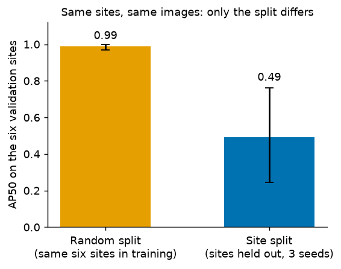
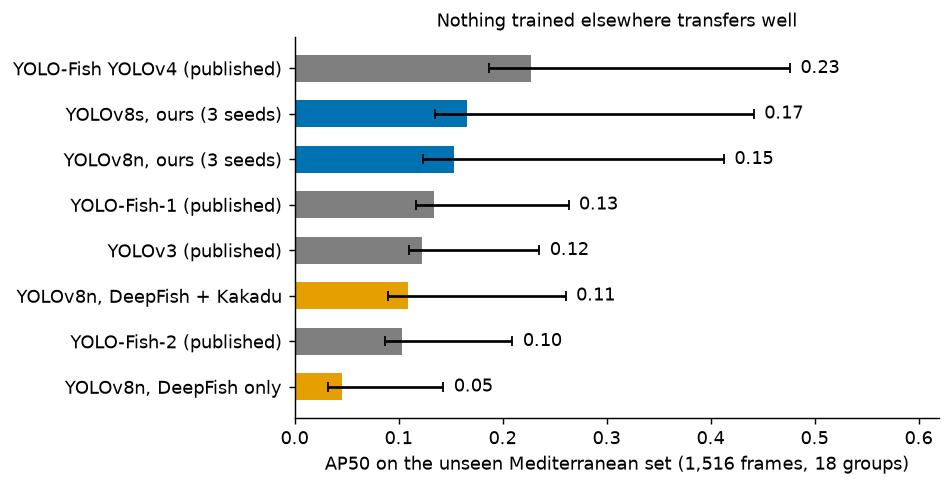
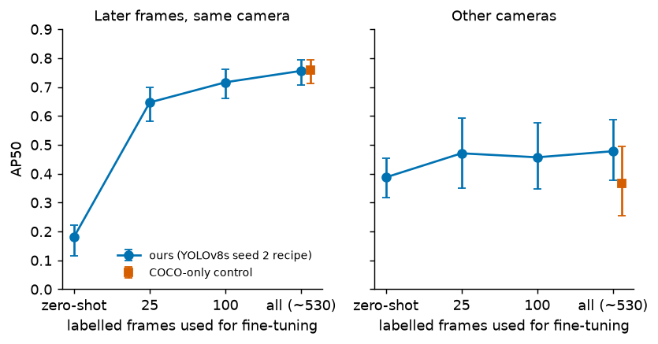
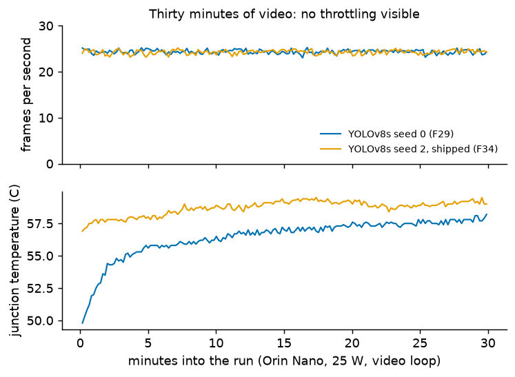

# What a fish-detection score means: split, data and device cost of a single-class YOLOv8 on a Jetson Orin Nano

*WACV 2028 Applications-track DRAFT (condensed from `paper.md`, started 2026-10-15). Target: 8 pages including figures and
tables, references extra (WACV 2027 rules; **recheck the 2028 author guide and kit when published**). Double-blind: no
names, no affiliations, no repository address, no acknowledgements, no "our earlier work" self-citation; code is
described as "to be released". Markdown stand-in until the 2028 LaTeX kit exists; then convert and cut to fit. Internal
finding ids (F#) are kept in square brackets for checking against `docs/PROGRESS.md` and **must be deleted before
submission**. Word budget: about 4,600 words of text plus 4 figures and 2 tables. If this text and `PROGRESS.md`
disagree, `PROGRESS.md` wins.*

## Abstract

A fish detector's reported score depends on how frames were split, which data trained it and whether the test source was seen. We train a single-class YOLOv8 detector from COCO weights on three open datasets (DeepFish, Kakadu, OzFish), evaluate it with site-level splits, a sealed test set scored once, cluster-bootstrap intervals and an unseen Mediterranean source, and run it on a Jetson Orin Nano. On the same six sites, a model trained on a random per-image split scores 0.99 AP50 and models that held the sites out score 0.49. Adding training sources raised site-held-out mAP@50 from 0.47 to 0.75 for YOLOv8n (0.81 for YOLOv8s, three seeds), more than resolution, augmentation, tiling or a second detector family. On an unseen source every detector we tried, including published YOLO-Fish weights, scored 0.05 to 0.23 AP50; 25 labelled frames from one fixed camera lifted later frames of that camera from 0.18 to 0.65. On the board (TensorRT FP16, built on the device, 25 W) the YOLOv8s engine takes about 50 ms per frame end to end and holds 24 fps over 30 minutes with no throttling visible. We state what remains unshown: no footage from a deployment site, one device run per model, and several single-seed screens.

## 1. Introduction

Baited and fixed underwater cameras record far more footage than people can review, and most frames contain no fish. A detector on a small computer at the camera could filter its own footage. We ask a practical question: **how accurate can a fish detector be made, and what does it cost on a Jetson Orin Nano, when both answers are measured on the device and on data the model has not seen?**

Three things make that harder than a benchmark number suggests. *Scores depend on the split:* neighbouring video frames are nearly identical, so a random per-image split lets the model see almost the test picture in training. On our pipeline the same model scores 0.98 mAP@50 on a random split of DeepFish and about 0.47 with whole capture sites held out [F20]. *Fish are small:* recall falls to about 3% for fish of 16 to 32 px at 960-px input [F10]. *Desktop speed is not device speed:* on the Orin the network is 8 to 11% of the time per frame [F8].

**Contributions.** (i) A leakage-controlled protocol (site splits, a sealed test used once, cluster-bootstrap intervals, a source no model saw) and a measurement of how much each part changes the number. (ii) A controlled comparison of what raises accuracy, with seed spread measured: more diverse data is the largest lever, and resolution, augmentation, tiling, a small-object head and a second detector family are not. (iii) A test on an unseen source, with published detectors scored by the same routine, and a fine-tuning study on one fixed camera. (iv) End-to-end and 30-minute measurements on the Orin Nano with the power mode stated. Throughout, one seed, split or dataset supports "observed", and we say so.

## 2. Related work

**Fish detection.** Early work compared hand-crafted features with CNNs (Villon et al., 2016) and moved to deep detectors, including motion-aware systems (Salman et al., 2020) and field abundance estimation (Ditria et al., 2020; one species, one habitat type). Most recent systems modify the YOLO family (Redmon et al., 2016): Zhang et al. (2024) add space-to-depth convolution, attention and an extra small-target layer to YOLOv8n, and AquaYOLO (Vijayalakshmi and Sasithradevi, 2025) targets aquaculture ponds on a private set split by image. YOLO-Fish (Muksit et al., 2022) adapted YOLOv3 and YOLOv4 to DeepFish and OzFish imagery and released weights, which we evaluate on an unseen source. Ayyagari et al. (2025) pre-trained YOLOv7 on public marine datasets and found every model poor on an out-of-distribution set, in line with our results. These papers differ in datasets, splits, image sizes and metrics, so we quote none as a baseline.

**BRUVS.** For baited remote underwater video, Marrable et al. (2022, 2023) fine-tune COCO-pretrained YOLOv5 on OzFish for detection and length measurement. The usual summary is MaxN, the largest count in one frame; false positives and negatives can cancel in it (Ditria et al., 2020), so we report counting error beside AP.

**Evaluation practice.** Leakage between non-independent samples is a documented failure across fields (Kapoor and Narayanan, 2023); recognition models degrade at new camera locations (Beery et al., 2018); reusing a test set can invalidate estimates (Dwork et al., 2015), though empirical studies find mixed evidence of harm (Recht et al., 2019; Roelofs et al., 2019). Cross-validation error bars understate the true error (Varoquaux, 2018), so we resample clips, sites or dates.

**Embedded fish detectors.** Zhang et al. (2026) report 19 to 24 fps for a 3.0 MB YOLOv11n derivative on an Orin Nano in a 15 W mode with FP32, TensorRT installed but not used, stages not decomposed and no thermal test. Other Jetson papers (Huang et al., 2025; Liu et al., 2025) use holothurian/echinus benchmarks and omit timing scope, power mode or sustained runs. Ours differ by building TensorRT FP16 engines on the board, timing end to end by stage, and logging 30 minutes of frame rate and temperature. The figures are still not like for like (larger input and model, 25 W), so we do not rank speeds.

## 3. Data and protocol

All boxes are converted to one class, `fish`.

**DeepFish** (Saleh et al., 2020): 6,517 frames and 15,463 boxes from tropical Australian habitats, in the YOLO-format export released with YOLO-Fish. We split by capture site: 14 training sites (5,178 frames) and 6 validation sites (1,339 frames, 20 clips, 34.7% empty). The code asserts that no site is on both sides. This validation split is the common yardstick.

**Kakadu** (Jansen et al., 2022): 44,112 frames of freshwater fish. It has no site labels, so we grouped frames by thumbnail similarity (2,296 groups), kept at most 15 per group (7,318 frames, 11,695 boxes) and use it **for training only**, because a held-out split inside it still leaked [F13].

**OzFish** (Australian Institute of Marine Science et al., 2019): crowded baited footage with crowd-sourced boxes (23.7 boxes per frame against 2.4 in DeepFish). A **sealed test set** of 352 frames, 8,329 boxes and 297 clips was read only under rules fixed beforehand. We later obtained the labelled OzFish pool, excluded every deployment in the test set, held out whole deployments (157 frames) for decisions and trained on 622 frames. After this, the sealed set measures new deployments of the same collections, not an unseen source.

**Unseen source.** A Mediterranean fish set (Catalan and Alvarez-Ellacuria, 2023; 1,516 frames, 17,157 boxes, 18 groups) contributed no training, validation or selection data.

**Protocol.** Splits are by site; mAP@50 and mAP@50-95 (Everingham et al., 2010; Lin et al., 2014) come from Ultralytics, and found/missed fish and false alarms at IoU 0.5 and confidence 0.25 come from a separate analysis. Every comparison has a same-machine, same-batch control. The baseline seed spread was 0.041 mAP@50, so smaller differences are not results; claims need three seeds, and one seed is called a screen. Intervals are 95% cluster bootstraps over clips, deployments, dates or groups.

## 4. Method

**Detector and training.** YOLOv8 n, s and m (Jocher et al., 2023): a convolutional backbone, multi-scale neck and anchor-free head at strides 8, 16 and 32, with non-maximum suppression. Models start from COCO weights and train for at most 150 epochs with early stopping (patience 30) and default augmentation. Checkpoints are chosen by Ultralytics fitness on the DeepFish validation split. Input is 640, 960 or 1280 px on the long side, letterboxed (a 1080p frame is evaluated at 544x960 for 960). Seeds, configs, library versions and the git commit are stored per run.

**Deployment.** ONNX is exported on a desktop and FP16 TensorRT engines are built on a Jetson Orin Nano 8 GB Super (L4T 36.4.7, TensorRT 10.3.0, active fan) at the shape the accuracy was evaluated at. Every frame rate states its `nvpmodel` mode. Latency is end to end (decode, letterbox, inference, NMS), warm-up discarded, median and 95th percentile; a GPU-kernel benchmark is never called a frame rate. Agreement with PyTorch is checked on real frames.

## 5. Results

### 5.1 The split decides the score

**Figure 1.** AP50 on the same six DeepFish validation sites (46 clips). A YOLOv8n trained on a random per-image split scores 0.989; three site-split controls score 0.491. 95% cluster-bootstrap intervals over clips. [F38; `runs/stats-20261011-leakage-control/leakage.json`]

The gap is about 0.50 (95% interval 0.22 to 0.75), so it is leakage and not harder validation sites. It is one random-split model and one seed.

### 5.2 More diverse data is the largest lever

Same machine, same batch, three seeds each, YOLOv8n at 960 px:

| Training data | mAP@50 (mean, range) | mAP@50-95 | Held-out OzFish mAP@50 |
|---|---|---|---|
| DeepFish only (control) | 0.473 (0.456 to 0.497) | 0.301 | 0.256 |
| + Kakadu | 0.698 (0.684 to 0.709) | 0.471 | 0.357 |
| + Kakadu + OzFish | 0.750 (0.740 to 0.764) | 0.514 | 0.689 |

**Table 1.** DeepFish validation unless stated. [F18, F24]

Adding Kakadu raised the score by 0.225 with every seed far above every control seed; the weakest combined seed (0.740) is above the best Kakadu-only seed (0.709). With whole clips resampled (20 clips), the Kakadu gain (+0.234 AP50, interval 0.116 to 0.339) and the YOLOv8s lead over YOLOv8n (+0.058, 0.012 to 0.104) stay positive, but the OzFish gain (+0.037, -0.001 to 0.091) is not separated from zero, so we call it probably real, not established [F35]. Absolute scores carry an uncertainty of about 0.1 at this number of clips. YOLOv8s on the combined data scores 0.812 mAP@50 (seeds 0.821, 0.787, 0.829; range 0.041) and 0.567 mAP@50-95; every YOLOv8s seed is above every YOLOv8n seed [F32]. YOLOv8s seeds range from 80 to 601 false alarms at a fixed 0.25 threshold, so the operating point must be chosen per model on validation.

### 5.3 What did not help

On the best model, test-time tiling found 8% more fish but raised false alarms 3.7 to 5 times and lowered AP, and no variant, including a small-box merge rule fixed in advance, beat the whole frame (0.817 AP50 untiled against 0.784 to 0.812) [F25, F26]. Training YOLOv8s at 1280 px did not raise small-fish recall (24.5% against 26.4% at 960) and cost 1.7x per epoch [F27]. A stride-4 head [F12] and stronger augmentation on top of the extra data [F23] gave nothing measurable. A torchvision Faster R-CNN (MobileNetV3-FPN) showed the same direction for added data (DeepFish validation 0.554 to 0.660; unseen source 0.098 to 0.134) [F40]. Several of these are one-seed screens (Section 6).

### 5.4 Where the detector fails

Recall depends on size (YOLOv8n, 960 px): about 3% for 16 to 32 px fish, 49% for 32 to 96 px, 91% above 96 px [F10]. Missing fish, not misplaced boxes, limits the detector: 523 of 688 misses had no prediction, 161 were found below the threshold and 4 were badly placed. As a counter, YOLOv8s finds 79 to 84% of labelled fish per frame, but its clip-level MaxN is 119 to 150% of the true maximum because false alarms inflate the largest frame [F36]. Greyscale costs 7 to 9% but wrong hue up to 49% [F4], which matters because water colour changes with depth.

### 5.5 Sealed OzFish test

Scored once on the three YOLOv8s seeds under a plan fixed beforehand: mAP@50 **0.700** (0.695, 0.701, 0.705) and mAP@50-95 0.380, precision 0.807, recall 0.610 [F33]. A second pass over the same predictions, only to add uncertainty and under rules fixed beforehand, gives AP50 0.697 with a 95% interval of 0.669 to 0.724 over 249 deployments [F37]. The test measures new deployments of data also used in training. It has no empty frames and so says nothing about false alarms.

### 5.6 An unseen source and adapting to one camera

**Figure 2.** AP50 on the unseen Mediterranean set. Ours: three-seed means; intervals over 18 groups are wide. All models scored by one routine (101-point AP); published detectors run through OpenCV with our letterboxing. [F39; `runs/unseen-20261011-deepecomar-labels/unseen.json`]

Every detector does poorly: 0.045 AP50 for DeepFish-only YOLOv8n, 0.109 with Kakadu, 0.154 with OzFish, 0.166 for YOLOv8s (interval 0.136 to 0.442 over groups), and 0.104 to 0.134 for YOLO-Fish-1, YOLO-Fish-2 and YOLOv3, with published YOLOv4 highest at 0.227. The ordering of our arms repeats Section 5.2, but the absolute level shows that cross-source generalisation is weak. The YOLOv4 weights are about eleven times larger and were trained on different data, so this is not a claim of superiority. A threshold chosen on DeepFish validation also lands at different operating points here (precision 0.54 to 0.86 across seeds).

**Figure 3.** Fine-tuning on n labelled early frames of one fixed camera (one seed per point). Left: later frames of the same camera (267 frames, 18 dates). Right: other cameras (630 frames). Square: COCO-only control on all early frames. [F41; `runs/adaptation-20261011/adaptation.json`]

We then ordered the 886 snapshots of one fixed camera by date: the earliest 60% were the training pool, the next 10% selected the epoch and the latest 30% formed the test, with rules fixed in advance. Twenty-five labelled frames raised AP50 on later frames from 0.18 (0.12 to 0.22) to 0.65 (0.58 to 0.70); 100 frames gave 0.72 and all early frames 0.76 (0.71 to 0.79). A COCO-only control reached the same 0.76, so our larger training set added nothing once the camera was seen. On other cameras the gain was small and uncertain (0.39 to 0.46 to 0.48, overlapping intervals) and the COCO-only control fell below zero-shot. This supports a label-a-little-then-fine-tune recipe for a known camera, not a new-site result.

### 5.7 Cost on the Jetson Orin Nano

| Engine (FP16, 25 W) | End to end, serial | Video loop, 30 min | Junction temp. |
|---|---|---|---|
| YOLOv8n, 960 px | 40.8 ms (24.5 fps) | about 34 fps | 50 to 56.5 C |
| YOLOv8s seed 2 (shipped) | 49.9 ms (about 20 fps) | 24.3 fps | max 59.5 C |

**Table 2.** One run each. Serial: JPEG decode, letterbox, GPU, NMS, 200 runs, median. Video loop: software H.264 decode (about 8 ms per frame against about 17.5 ms for JPEG). Ambient not measured; no throttling visible. [F8, F9, F28, F29, F34]

The GPU kernel is 2.56 ms at 640 px and 4.37 ms at 960 px for YOLOv8n, 8 to 11% of the frame; decode, letterboxing and copies dominate [F8]. YOLOv8s adds 9 ms because only the GPU stage grows (23.6 against 14.3 ms) [F28], buying about 0.06 mAP@50 over three seeds. MAXN_SUPER left the GPU stage unchanged and sped only CPU decode, so 10-minute video rates did not change [F31]. Engines agree with PyTorch on 12 real frames (worst IoU 0.990 for the YOLOv8s engine) [F7, F30, F34].

**Figure 4.** Thirty minutes of looped video on the Orin Nano (25 W, `jetson_clocks` inactive), YOLOv8s FP16, seed 0 and the shipped seed 2. The temperature axis does not start at zero. One run each. [`runs/device-20261007/sustained_*.jsonl`]

## 6. Limitations

(1) Several comparisons are single-seed screens (augmentation, stride-4 head, 1280 px, tiling, second family, adaptation). (2) Checkpoint selection, early stopping and the choice of the shipped seed used the 20-clip DeepFish validation split that is also the headline table, so those scores are mildly optimistic; only the sealed OzFish set was untouched by decisions. (3) Frames from one video are not independent: clip-level intervals show absolute scores uncertain by about 0.1. (4) OzFish labels are crowd-sourced, so an unlabelled fish scores as a false alarm. (5) The adaptation test uses a known scene, not a new site. (6) Device results are one 30-minute run per model in one power mode, with ambient unmeasured, no INT8 and no on-device mAP. (7) **There is no footage from a deployment site.** Ultralytics code and weights are AGPL-3.0, which applies to any copy that leaves the institution.

## 7. Conclusion

Accuracy was limited by data and by evaluation, not by the architecture we tried: diverse training sources lifted site-held-out mAP@50 from 0.47 to 0.75 (0.81 for YOLOv8s), the same pipeline scored 0.99 on a leaky split, and no detector, ours or published, exceeded 0.23 AP50 on an unseen source. A few dozen labelled frames from the target camera recovered much of the gap for that camera. The device was not the bottleneck: the shipped engine runs at about 50 ms per frame end to end and holds 24 fps over 30 minutes at 25 W. Next steps are footage and labels from the intended site, a second validation source so that selection and the final claim no longer share a split, repeated device runs across power modes and ambient temperatures, and counting as the field metric. Code, configurations, run records and weights will be released under AGPL-3.0 after review.

## Ethics and reproducibility

Only openly licensed footage of fish is used and no animals or people were handled; outputs need human review where a decision depends on them. Every table except the first Kaggle baselines (which are not used here) is regenerable from a committed configuration and run folder; splits, seeds and the sealed-set rule are fixed in an evaluation protocol. Data licences: DeepFish (MIT), Kakadu (CC BY 4.0), OzFish (CC BY 3.0 AU).

## References

Same entries as `paper.md` minus Muksit's figures; see `references.bib`. Cited: Australian Institute of Marine Science et al. (2019); Ayyagari et al. (2025); Beery et al. (2018); Catalan and Alvarez-Ellacuria (2023); Ditria et al. (2020); Dwork et al. (2015); Everingham et al. (2010); Huang et al. (2025); Jansen et al. (2022); Jocher et al. (2023); Kapoor and Narayanan (2023); Lin et al. (2014); Liu et al. (2025); Marrable et al. (2022, 2023); Muksit et al. (2022); Recht et al. (2019); Redmon et al. (2016); Roelofs et al. (2019); Saleh et al. (2020); Salman et al. (2020); Varoquaux (2018); Vijayalakshmi and Sasithradevi (2025); Villon et al. (2016); Zhang et al. (2024, 2026).
